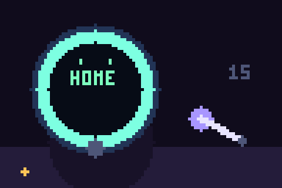

# Solana Gadget Kit

The round screen asks. You press. Then, and only then, the arm may move.



That loop is the whole desk in one breath. Home, a wink, review, a physical press, a signature, and the servo marked 15. Early frames leave the arm down. `15` stays dim until the press lands.

This checkout is the Muse gadget tree plus five host programs you can run on a computer. The programs do not flash a board, open a network connection, or spend a funded key. Build them here, in this directory.

## What lives here

| Path | What it is |
|---|---|
| `examples/hardware_wallet.c` | Host program `hardware_wallet`. Refuses secret export. Signs only after a physical confirm. |
| `examples/lcd_status.c` | Host program `lcd_status`. Frames are home, review, expired, and cancelled at 240×240. |
| `examples/robotics_gate.c` | Host program `robotics_gate`. Applies `servo:15` only for a matching in-window `arm.nudge`. |
| `examples/solana_os_check.c` | Host program `solana_os_check`. Checks a Solana OS 0.4.4 directory against `SHA256SUMS`. |
| `examples/portfolio_preview.c` | Host program `portfolio_preview`. Fixed quote: 10000000 lamports, 2500000 USDC base units, minimum out 980000. |
| `src/` and `include/` | Host library behind those programs: wallet, LCD review, robotics gate, portfolio preview, SHA-256, and the confirmation record. |
| `tests/host_test.c` | `make test` runs this file. It checks the same confirm, export, LCD, and robotics rules. |
| `esp32/` | ESP32 device SDK. |
| `linux/` | Linux device SDK. The Muse gadget link, not the Modulino bus below. |
| `android/musegadgetstest/` | Android test app. It streams video to a gadget display. |
| `musegadgetstest/` | iOS test app. Same job, on iPhone. |
| `dashboard/` | Offline 240×240 review page, `dashboard/index.html`. |
| `web-flasher/` | Browser installer: `index.html`, `boards.json`, `flasher-hooks.js`, `paced-serial.js`, `sdk-token.js`, and `make_manifest.py`. |
| `docs/solana-os.md` | Flash note for the BP26 badge. It still names `firmware/solana-os/0.4.4`. |
| `scripts/flash-solana-os.sh` | Terminal flash script. It still resolves `firmware/solana-os/0.4.4`. |
| `0.4.4/` | Prebuilt Solana OS 0.4.4 images for the BP26 badge, plus `SHA256SUMS`. |
| `.github/` | Only `modernize/java-upgrade`. This checkout has no `.github/workflows/esp32.yml`. |
| `.vscode/settings.json` | Editor setting. CMake's source directory is `esp32/`. |

`tests/readme_check.py` reads this file and `docs/hero.gif` from disk.

## Build and run

From this directory:

```sh
make test
make examples
./build/hardware_wallet
./build/lcd_status
./build/robotics_gate
./build/portfolio_preview
./build/solana_os_check 0.4.4
```

`./build/solana_os_check` with no arguments is not the success case. With no path, `examples/solana_os_check.c` looks for `firmware/solana-os/0.4.4` and `../firmware/solana-os/0.4.4`. Point the checker at `0.4.4`.

The Makefile compiles Pocket Wallet from the sibling directory `../pocket-wallet` (`-I../pocket-wallet/firmware/components/pocket_wallet`). That sibling stays outside this tree.

The demo seed `solana-gadget-kit-hw-wallet-seed` is not a funded key. It is the 32-byte text the host wallet uses so the same payload signs the same way on every run. Secret export is refused. A signature is produced only after a physical confirm.

Primary lines from those five programs:

```text
secret_export=refused
240x240 REVIEW transfer 0.01 SOL
WALLET signature=9d9ec360e8aa31b6cd914e49b06dc6d2284b36148bf173138c3ea843c098e63fcfce2e91895c6de3b68ae43aba6e82941c81c3948452fc012cdce89803bcd00f confirmed_verify=ok unconfirmed=refused
LCD 240x240 HOME
LCD 240x240 REVIEW pay 0.01 SOL for 1 USDC
LCD 240x240 EXPIRED
LCD 240x240 CANCELLED
LCD frames=home,review,expired,cancelled size=240x240
ROBOTICS match=applied mismatch=refused expired=refused cancelled=refused missing=refused
PORTFOLIO sol=0.010000000 usdc=2.500000 quote_min_out=0.980000 venue=fixture
SOLANA_OS 0.4.4 checksums=ok files=4
```

LCD frames are home, review, expired, and cancelled at 240×240. Robotics applies `servo:15` only for a matching in-window `arm.nudge` and refuses mismatch, expiry, cancel, and a missing confirmation. Portfolio preview is the fixed quote (10000000 lamports, 2500000 USDC base units, minimum out 980000).

## Where the BP26 images actually are

The four images and `SHA256SUMS` live in `0.4.4/`:

| Offset | File |
|---|---|
| `0x2000` | `bootloader.bin` |
| `0x8000` | `partition-table.bin` |
| `0xf000` | `ota_data_initial.bin` |
| `0x20000` | `solana_os.bin` |

`examples/solana_os_check.c`, `scripts/flash-solana-os.sh`, and `docs/solana-os.md` still look for `firmware/solana-os/0.4.4`. That directory is not in this checkout. Checksums succeed when you pass `0.4.4` yourself. The badge notes in `0.4.4/README.txt` are the image list and the esptool line for a Solana BP26 (ESP32-C5, CH340). This README does not retarget the script or the checker.

## SolanaOS, kept next door

Integrate [SolanaOS](https://github.com/themusebook/solanaos) without merging trees. SolanaOS stays the Go local-first trading runtime. Its module path is `github.com/x402agent/Solana-Os-Go`. Do not merge the trees. Do not vendor SolanaOS.

Its `solanaos hardware` commands drive an Arduino Modulino I2C cluster on Linux: distance 0x29, buzzer 0x3C, thermo 0x44, movement 0x6A, pixels 0x6C, knob 0x76, buttons 0x7C. That cluster is not the Muse ESP32/Linux gadget link and not the BP26 badge. Those buses are not the same protocol.

Use each one for the job it already has:

- SolanaOS keeps trading, the local Go process, and `solanaos hardware` on the Modulino I2C bus (scan, test, monitor, demo).
- This kit is the review/sign peripheral: no secret export, a signature only after a physical confirm, a 240×240 review, and the robotics gate. A SolanaOS command that needs a signature or a motion stops at `gadget_wallet_review` until `gadget_wallet_confirm` sees the physical edge. Mismatch, expiry, cancel, and a missing confirmation do not move the servo.
- The prebuilt Solana OS 0.4.4 flash in `0.4.4/` is a separate BP26 image set. It is not the Modulino cluster and not the host wallet.

No Go bridge is added here. The host programs above are the boundary you can run before any board is attached.
